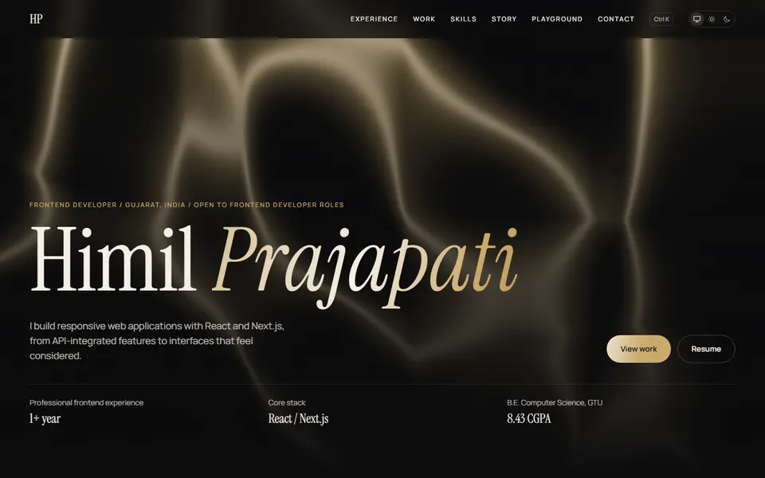
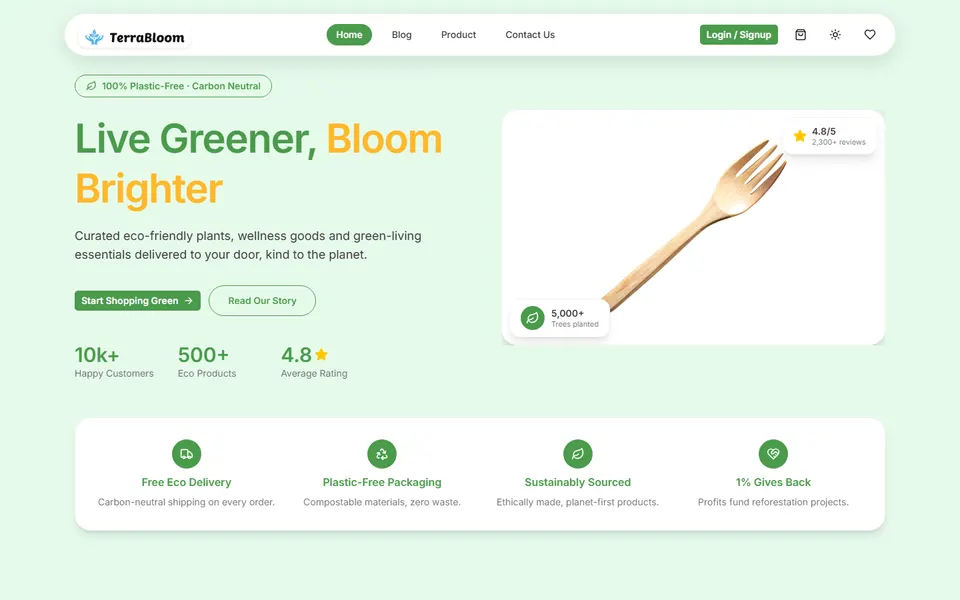
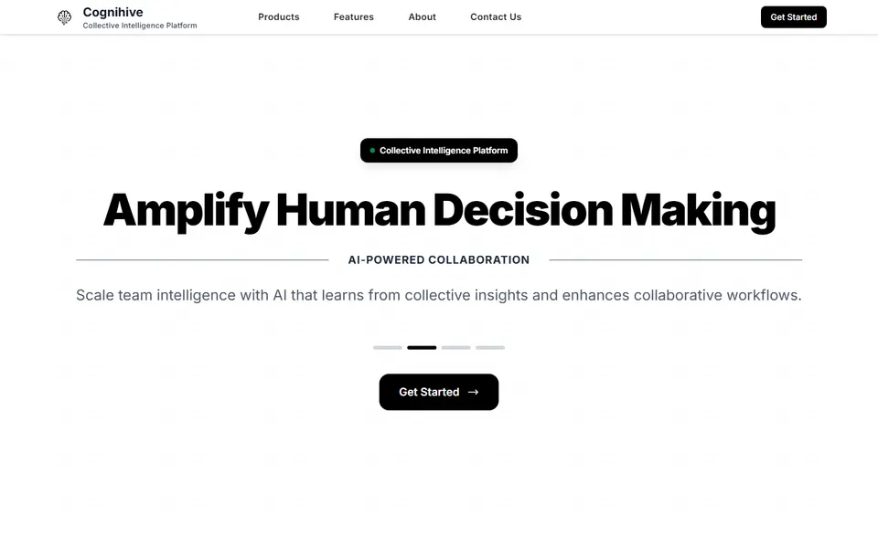
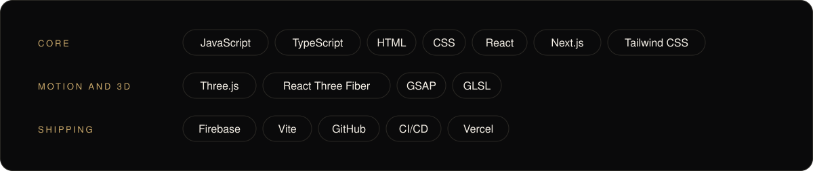

<a href="https://himil-portfolio.vercel.app">
  <picture>
    <source media="(prefers-color-scheme: dark)" srcset="assets/banner-dark.svg">
    <source media="(prefers-color-scheme: light)" srcset="assets/banner-light.svg">
    
  </picture>
</a>

  <a href="https://himil-portfolio.vercel.app"><b>Portfolio</b></a> &nbsp;/&nbsp;
  <a href="https://www.linkedin.com/in/himil-prajapati"><b>LinkedIn</b></a> &nbsp;/&nbsp;
  <a href="mailto:himilprajapati@gmail.com"><b>Email</b></a>

<i>Open to frontend developer roles.</i>

## Selected work

<table>
  <tr>
    <td width="33%" valign="top">
      
        
      <b><a href="https://github.com/Himil192/himil-portfolio">This portfolio</a></b>
       
      Next.js, TypeScript, and Three.js. Visuals written in code, with a molten gold theme change.
    </td>
    <td width="33%" valign="top">
      
        
      <b><a href="https://github.com/Himil192/TerraBloom">TerraBloom</a></b>
       
      Eco-focused store and blog with customer and admin dashboards. 29 pages, 38 components.
    </td>
    <td width="33%" valign="top">
      
        
      <b>Cognihive landing page</b>
       
      The 7-section public landing page for an enterprise AI company, in React and Next.js.
    </td>
  </tr>
</table>

## Will I fit your role?

My portfolio has a tool that checks a job description against my real experience, with evidence for every match and an honest list of what I haven't used yet.

<a href="https://himil-portfolio.vercel.app/#playground">
  <picture>
    <source media="(prefers-color-scheme: dark)" srcset="assets/match-dark.svg">
    <source media="(prefers-color-scheme: light)" srcset="assets/match-light.svg">
    
  </picture>
</a>

<a href="https://himil-portfolio.vercel.app/#playground"><b>Try it with your own job description</b></a>

## Experience

| Role | Company | Period |
|---|---|---|
| Frontend Developer | Cognihive LLC | Aug 2025 – Jun 2026 |
| Junior React Developer Intern | Neonat Health | Jan 2025 – Apr 2025 |

## Toolkit

<picture>
  <source media="(prefers-color-scheme: dark)" srcset="assets/skills-dark.svg">
  <source media="(prefers-color-scheme: light)" srcset="assets/skills-light.svg">
  
</picture>
